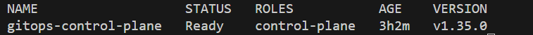
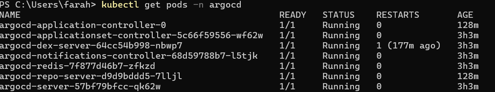
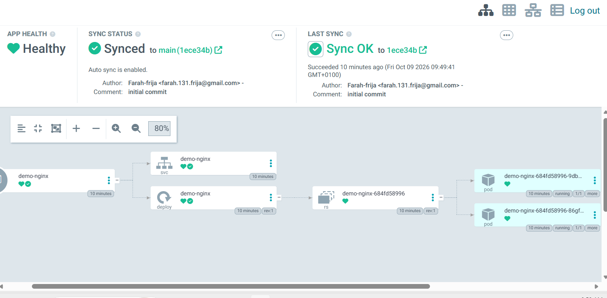
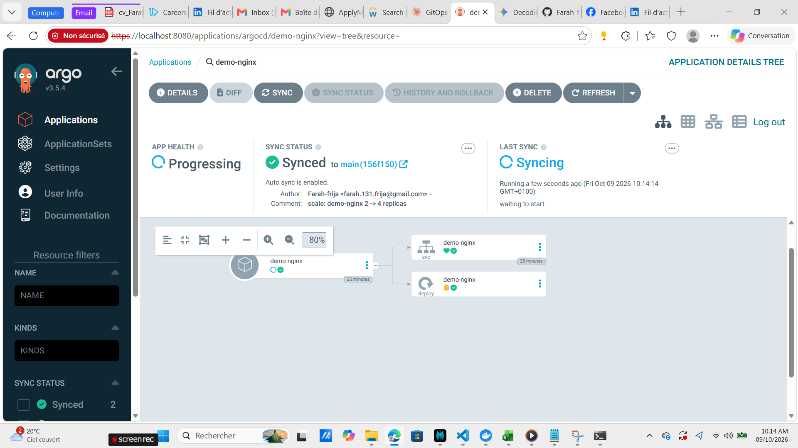
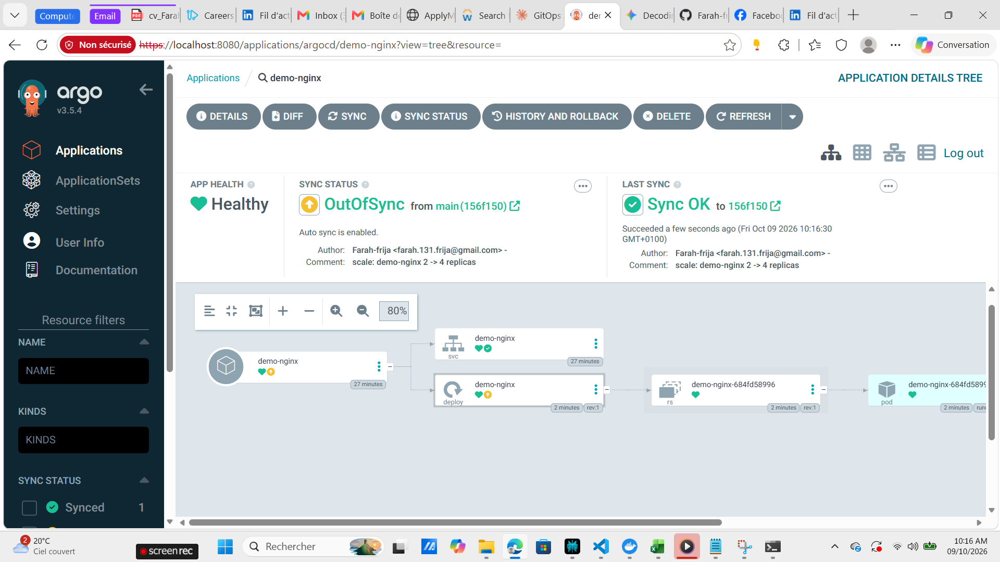
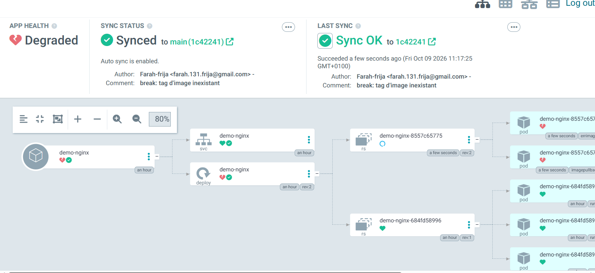
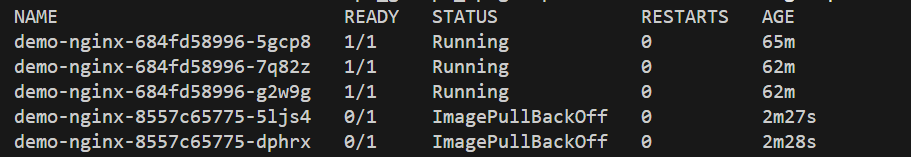
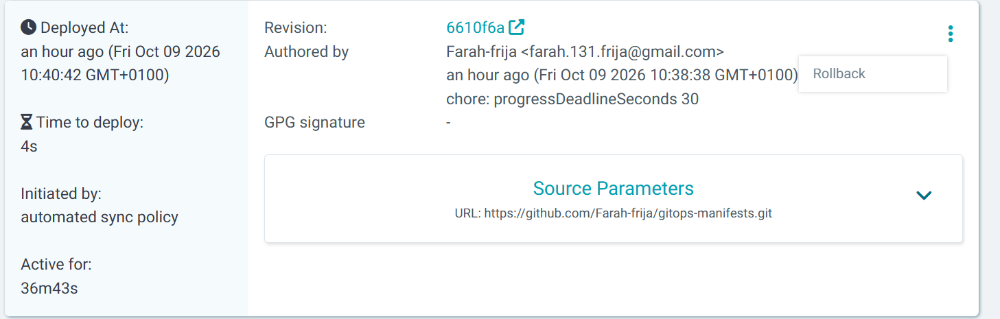
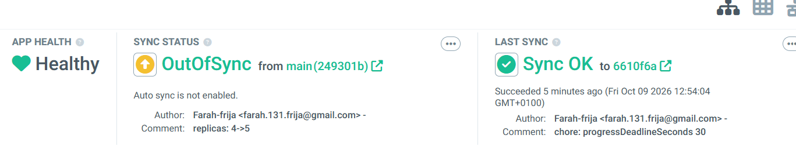
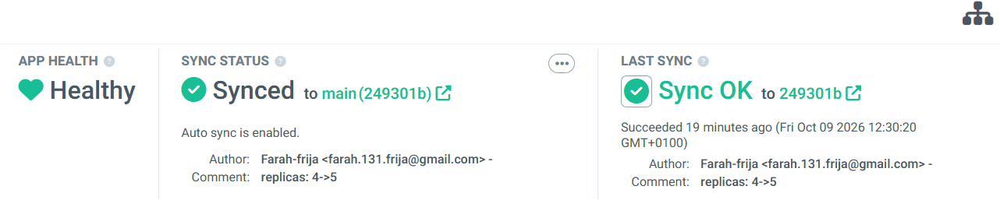

# TP : Mise en œuvre du Continuous Deployment avec GitOps et ArgoCD

**Étudiante :** Farah Frija - Ali Wala - Gharbi Emna - Zarrouki Rima — DevOps Avancé, INSAT, 5ᵉ année Génie Logiciel
**Date :** 09/10/2026


---

## 1. Introduction

Ce TP illustre la démarche GitOps avec ArgoCD : Git est l'unique source de vérité (SSOT) et ArgoCD applique en mode *pull* l'état désiré sur le cluster Kubernetes.

**Application choisie :** serveur NGINX (`nginx:1.25`), exposé via un Service ClusterIP. L'évaluation porte sur le pipeline GitOps, pas sur l'application.

---

## 2. Étape 1 : Structure du dépôt Git (Kustomize)

### 2.1 Arborescence

```
gitops-manifests/
├── base/
│   ├── deployment.yaml
│   ├── service.yaml
│   └── kustomization.yaml
├── overlays/
│   └── dev/
│       └── kustomization.yaml
└── argocd/
    └── application.yaml
```

### 2.2 Justification

- **Kustomize** : approche déclarative structurée, sans templating.
- **`base/`** : manifests communs (Deployment + Service).
- **`overlays/dev/`** : personnalisation de l'environnement (namespace `demo`, nombre de réplicas = 2, tag d'image). C'est ce fichier qui sera modifié pour les démonstrations.
- **`argocd/application.yaml`** : l'objet Application ArgoCD, versionné lui aussi.

### 2.3 Extraits clés

`base/deployment.yaml` : image `nginx:1.25`, readinessProbe HTTP sur `/`, requests/limits définis.

`overlays/dev/kustomization.yaml` :

```yaml
namespace: demo
resources:
  - ../../base
images:
  - name: nginx
    newTag: "1.25"
replicas:
  - name: demo-nginx
    count: 2
```

### 2.4 Vérification du rendu

```bash
kubectl kustomize overlays/dev
```


### 2.5 Publication sur Git

```bash
git init && git add . && git commit -m "feat: initial kustomize structure"
git branch -M main
git remote add origin https://github.com/<TON_USER>/gitops-manifests.git
git push -u origin main
```


---

## 3. Étape 2 : Configuration d'ArgoCD

### 3.1 Création du cluster Kubernetes (kind)

```bash
kind create cluster --name gitops
kubectl cluster-info --context kind-gitops
kubectl get nodes
```



### 3.2 Installation d'ArgoCD

```bash
kubectl create namespace argocd
kubectl apply -n argocd --server-side --force-conflicts -f https://raw.githubusercontent.com/argoproj/argo-cd/stable/manifests/install.yaml
kubectl wait --for=condition=available deployment --all -n argocd --timeout=300s
kubectl get pods -n argocd
```

L'option `--server-side` évite l'erreur « annotation too long » liée à la taille des CRD d'ArgoCD.


| Pod | Rôle |
|---|---|
| `argocd-server` | L'API et l'interface web (l'UI sur `localhost:8080`) |
| `argocd-repo-server` | Clone le dépôt Git et génère les manifests (c'est lui qui exécute `kustomize build`) |
| `argocd-application-controller` | Le cerveau : compare Git et le cluster, détecte le drift, synchronise et fait le self-healing |
| `argocd-redis` | Cache utilisé par les autres composants |
| `argocd-dex-server` | Authentification SSO (peu utile ici) |
| `argocd-applicationset-controller` | Génère des Applications automatiquement à partir de modèles |
| `argocd-notifications-controller` | Envoie des notifications (Slack, mail…) |

### 3.3 Accès à l'interface web

```bash
kubectl port-forward svc/argocd-server -n argocd 8080:443
```

Interface : https://localhost:8080 (certificat auto-signé à accepter). Identifiant : `admin`. Mot de passe initial :

Sous PowerShell (Windows), la commande `base64` n'existe pas ; on décode avec .NET :

```powershell
$p = kubectl -n argocd get secret argocd-initial-admin-secret -o jsonpath="{.data.password}"
[System.Text.Encoding]::UTF8.GetString([System.Convert]::FromBase64String($p))
```

> 📸 *Capture à insérer : page de connexion puis tableau de bord vide*

### 3.4 Création de l'Application ArgoCD

L'Application (`argocd/application.yaml`) relie le dépôt Git au cluster avec la synchronisation automatique et le self-healing :

```yaml
syncPolicy:
  automated:
    prune: true      # supprime du cluster ce qui n'est plus dans Git (Git → cluster)
    selfHeal: true   # corrige toute modification manuelle (drift) (Cluster → remis comme Git)
  syncOptions:
    - CreateNamespace=true
```

```bash
kubectl apply -f argocd/application.yaml
kubectl get applications -n argocd
kubectl get all -n demo
```



---

## 4. Démonstrations

### 4.1 Déploiement continu automatisé

**Objectif :** montrer qu'un simple commit Git suffit à modifier le cluster, sans aucune commande `kubectl` de déploiement.

**État initial :** application `demo-nginx` Synced / Healthy, 2 réplicas.


**Action :** dans `overlays/dev/kustomization.yaml`, passage de `count: 2` à `count: 4`, puis commit et push.

```powershell
git add . ; git commit -m "scale: demo-nginx 2 -> 4 replicas" ; git push
```

**Observation :**

```powershell
kubectl get pods -n demo -w
kubectl get deployment demo-nginx -n demo
```

ArgoCD détecte le nouveau commit (statut `OutOfSync` brièvement), synchronise automatiquement, et le Deployment passe à 4/4 réplicas.


**Conclusion :** le déploiement est piloté uniquement par Git (pull-based, SSOT). Aucun accès direct au cluster n'a été nécessaire.

### 4.2 Détection du drift et Self-Healing

**Objectif :** montrer qu'une modification manuelle du cluster (*configuration drift*) est détectée puis annulée automatiquement, car seul Git fait foi.

**État initial :** application Synced / Healthy, 4 réplicas.

**Scénario A : suppression d'une ressource**

```powershell
kubectl delete deployment demo-nginx -n demo
kubectl get pods -n demo -w
```

ArgoCD détecte que la ressource déclarée dans Git n'existe plus sur le cluster (statut `OutOfSync` / `Missing`), puis la recrée immédiatement grâce au `selfHeal: true`. Les 4 pods redémarrent.



**Scénario B : modification d'une ressource**

```powershell
kubectl scale deployment demo-nginx -n demo --replicas=1
kubectl get deployment demo-nginx -n demo -w
```


Le nombre de réplicas est forcé à 1 à la main. ArgoCD constate l'écart avec Git (4 réplicas) et le corrige automatiquement.


**Conclusion :** ArgoCD compare en continu l'état réel du cluster avec l'état désiré dans Git. Toute dérive est corrigée sans intervention : le cluster ne peut pas s'écarter durablement de Git.

### 4.3 Sync Status vs Health Status

**Objectif :** montrer que *Synced* (le cluster correspond à Git) et *Healthy* (l'application fonctionne) sont deux notions indépendantes.

**Préparation :** ajout de `progressDeadlineSeconds: 30` dans `base/deployment.yaml`, au niveau du `spec` du Deployment (et non dans `template.spec`, qui décrit les pods : Kubernetes ignorerait le champ et ArgoCD afficherait un `OutOfSync` permanent). Par défaut Kubernetes attend 10 minutes avant de déclarer un déploiement en échec ; avec 30 secondes, l'état *Degraded* apparaît rapidement pendant la démonstration.

```yaml
spec:
  progressDeadlineSeconds: 30
```

**Action :** introduction d'une erreur dans Git, dans `overlays/dev/kustomization.yaml`, avec un tag d'image inexistant :

```yaml
images:
  - name: nginx
    newTag: "9.99.99-inexistant"
```

```powershell
git add . ; git commit -m "break: tag d'image inexistant" ; git push
```

**Observation :**

```powershell
kubectl get pods -n demo
kubectl describe pod <nom-du-pod-en-erreur> -n demo
```

| Indicateur | Valeur | Signification |
|---|---|---|
| Sync Status | **Synced** | Le cluster correspond exactement à Git (même si Git contient une erreur) |
| Health Status | **Progressing** puis **Degraded** | Le nouveau pod ne démarre pas |
| Pod | `ErrImagePull` / `ImagePullBackOff` | L'image demandée n'existe pas dans le registre |

Les anciens pods continuent de tourner pendant l'échec grâce à la stratégie RollingUpdate : l'application reste disponible.




**Conclusion :** ArgoCD vérifie deux choses distinctes. *Sync* = « ce qui est déployé est-il identique à Git ? ». *Health* = « ce qui est déployé fonctionne-t-il ? ». Ici la synchronisation est parfaite, mais la santé est dégradée, car l'erreur vient de la déclaration elle-même.

### 4.4 Historique et Rollback

**Objectif :** revenir rapidement à une version stable après le déploiement défectueux de la démo 3.

**État initial :** application `Synced` / `Degraded` (image inexistante).

**Étape 1 : consulter l'historique.** Onglet **History and Rollback** : chaque synchronisation réussie y figure avec son commit, son auteur et sa date. La révision stable est celle du commit `fix: progressDeadlineSeconds au niveau du Deployment`.



**Étape 2 : désactiver l'Auto-Sync.** ArgoCD refuse le rollback tant que la synchronisation automatique est active (elle ré-appliquerait aussitôt le dernier commit Git). Dans l'UI : **App Details → Sync Policy → Disable Auto-Sync**.

**Étape 3 : rollback.** Dans **History and Rollback**, sur la révision stable : menu **⋮ → Rollback**, puis confirmation.

```powershell
kubectl get pods -n demo -w
kubectl get deployment demo-nginx -n demo -o jsonpath="{.spec.template.spec.containers[0].image}"
```

Les pods repassent en `Running` avec `nginx:1.25` et l'état de santé redevient `Healthy`. Le statut de synchronisation est alors `OutOfSync` : c'est normal, le cluster est revenu à l'ancienne révision alors que Git contient encore le commit défectueux.



**Étape 4 : corriger Git durablement.** Le rollback est temporaire. On annule le mauvais commit dans Git (nouveau commit, sans réécrire l'historique), puis on réactive l'automatisation :

```powershell
git revert HEAD --no-edit ; git push
kubectl apply -f argocd/application.yaml
```

La seconde commande réapplique l'Application telle que définie dans Git (Auto-Sync, Prune et Self-Heal), et l'état redevient `Synced` / `Healthy`.



**Conclusion :** ArgoCD conserve l'historique des déploiements, ce qui permet un retour immédiat à un état stable depuis l'UI. Le rollback sert à rétablir le service rapidement ; la correction définitive passe ensuite par Git, qui reste la source de vérité.

---

## 5. Conclusion

Ce TP a illustré les principes de GitOps avec ArgoCD :

| Concept | Démonstration |
|---|---|
| Single Source of Truth | Tout l'état désiré (Deployment, Service, overlay Kustomize, Application) est décrit dans Git |
| Continuous Deployment pull-based | Un commit suffit à modifier le cluster (réplicas 2 → 4), sans `kubectl apply` |
| Drift & Self-Healing | Suppression ou modification manuelle annulée automatiquement |
| Sync vs Health | Image inexistante : `Synced` (conforme à Git) mais `Degraded` (pods en `ErrImagePull`) |
| Rollback & historique | Retour à une révision stable depuis l'UI, puis correction durable par `git revert` |

La principale leçon est que Git devient le seul point d'entrée pour modifier l'infrastructure : le cluster ne s'écarte plus durablement de ce qui est versionné, chaque changement est traçable et réversible.